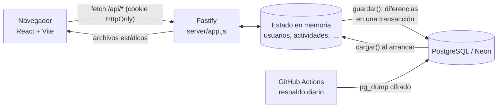
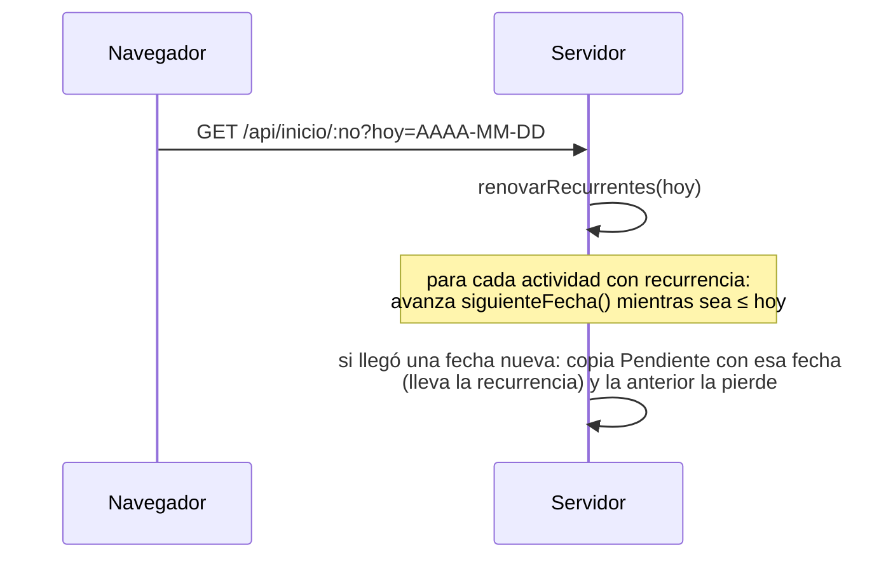

# Documentación del sistema — Seguimiento de Actividades

Documento técnico de todo el sistema: para qué sirve, cómo está construido, qué hace cada archivo, la API, el modelo de datos, la base de datos, la seguridad, el despliegue y los respaldos. El [README](README.md) es la guía corta de uso; este documento es la referencia completa.

## Índice

1. [Qué es](#1-qué-es)
2. [Arquitectura](#2-arquitectura)
3. [Tecnologías y librerías](#3-tecnologías-y-librerías)
4. [Estructura de carpetas](#4-estructura-de-carpetas)
5. [Roles y permisos](#5-roles-y-permisos)
6. [Funcionalidades](#6-funcionalidades)
7. [Frontend (`src/`)](#7-frontend-src)
8. [Servidor (`server/app.js`)](#8-servidor-serverappjs)
9. [API REST](#9-api-rest)
10. [Modelo de datos](#10-modelo-de-datos)
11. [Base de datos (PostgreSQL / Neon)](#11-base-de-datos-postgresql--neon)
12. [Seguridad](#12-seguridad)
13. [Idioma, tema y diseño](#13-idioma-tema-y-diseño)
14. [Pruebas](#14-pruebas)
15. [Despliegue, variables de entorno y respaldos](#15-despliegue-variables-de-entorno-y-respaldos)
16. [Límites conocidos](#16-límites-conocidos)
17. [Bitácora de incidentes](#17-bitácora-de-incidentes)

---

## 1. Qué es

Aplicación web para asignar, dar seguimiento y medir las actividades de los turnos de una planta (departamentos como Liquid Cooling, Pruebas Funcionales o SMT). Los encargados (Gerente, Senior, Ing. Full) crean y clasifican las actividades de su equipo por **criticidad**, y las marcan urgentes cuando hace falta. Los ejecutores (Ing. Jr, Técnico) las actualizan, agregan las suyas y piden cambios. El sistema avisa en el Buzón, hereda actividades entre turnos, genera reportes y una matriz de seguimiento. Los super administradores manejan las cuentas y la auditoría.

Turnos (en pantalla "Turno N · Nombre"; guardados con su clave interna):

| Turno | Clave | Horario |
|---|---|---|
| 1 · Matutino | `A` | 07:00–15:00 |
| 2 · Vespertino | `B` | 15:00–22:30 |
| 3 · Nocturno | `C` | 22:30–07:00 (termina al día siguiente) |
| 4 · Administrativo | `D` | 08:00–17:30 |

El que sigue al 3 es el 1 del día siguiente; el administrativo sigue con el administrativo del día siguiente. El reloj de la portada dibuja los tres rotativos y el administrativo como un arco interior.

## 2. Arquitectura

Un solo servicio Node.js. **Fastify** atiende la API (`/api/*`) y además sirve el frontend compilado (`dist/`). Los datos se trabajan **en memoria** y, con `DATABASE_URL`, se guardan en **PostgreSQL** (Neon): al arrancar se carga todo y, después de cada petición que cambia algo, se escribe solo lo que cambió, antes de responder.



El flujo de una petición tiene cuatro pasos:
1. **`onRequest`:** cierra las urgentes cuyo turno terminó.
2. **`preHandler`:** valida la sesión y que el número de empleado de la petición sea el de la sesión.
3. **Handler:** cambia el estado en memoria.
4. **`onSend`:** si la petición no es `GET`, guarda en PostgreSQL y después responde.

## 3. Tecnologías y librerías

| Pieza | Librería / herramienta | Versión | Para qué |
|---|---|---|---|
| Lenguaje | JavaScript (ES modules) | Node ≥ 20 | Todo el proyecto (`"type": "module"`) |
| Frontend | **React** + **react-dom** | 19.3 | Interfaz (componentes de función y hooks) |
| Empaquetador | **Vite** + `@vitejs/plugin-react` | 8.3 / 6.1 | Servidor de desarrollo y compilación a `dist/` |
| Servidor HTTP | **Fastify** | 5.12 | API, validación con JSON Schema, hooks |
| Archivos estáticos | **@fastify/static** | 10.1 | Servir `dist/` y el `index.html` de la SPA |
| Base de datos | **pg** (node-postgres) | 8.16 | Conexión a PostgreSQL / Neon (`pg.Pool`) |
| MFA | **qrcode** | 1.5 | QR del alta en la app autenticadora (se carga solo al usarse) |
| Excel | **read-excel-file** | 9.3 | Leer la plantilla `.xlsx` de un departamento (se carga solo al usarse) |
| PDF | **jspdf** + **jspdf-autotable** | 4.2 / 5.0 | Reporte en PDF real (vista previa y descarga) en `src/pdf.js`; se carga solo al exportar |
| Lint | **oxlint** | 1.89 | Revisión de código (`npm run lint`) |
| Pruebas | `node:test` + `node:assert` | integrado | Pruebas de API, BD y utilidades |
| Navegador de prueba | Playwright (fuera del repo) | — | Verificación visual durante el desarrollo |
| Criptografía | `node:crypto` | integrado | scrypt (contraseñas), HMAC-SHA1 (TOTP), tokens aleatorios |
| Hosting | **Render** (plan free) | — | Servicio web (`render.yaml`) |
| Base de datos administrada | **Neon** | PostgreSQL 16+ | Base de producción |
| Respaldos | **GitHub Actions** + `pg_dump` (imagen `postgres:18`) + OpenSSL | — | Respaldo diario cifrado |
| Tipografía | IBM Plex Sans / IBM Plex Mono | — | Fuentes de la interfaz |

No usa framework de CSS, router, gestor de estado ni ORM: CSS propio con tokens, rutas por `location.hash`, estado con `useState` y SQL generado desde la tabla de columnas de `server/db.js`.

## 4. Estructura de carpetas

```
├── index.html              Página base: aplica el tema guardado antes de pintar
├── vite.config.js          Configuración de Vite (plugin de React)
├── render.yaml             Blueprint de Render (build y start)
├── package.json            Dependencias y scripts
├── public/
│   ├── favicon.svg         Logo (reloj de turnos con palomita)
│   └── plantilla-departamento.xlsx   Ejemplo de plantilla de departamento
├── .github/workflows/
│   └── respaldo.yml        Respaldo diario cifrado de la base
├── server/
│   ├── index.js            Arranque: SUPERADMINS, conexión a la BD, carga y listen
│   ├── app.js              build(): toda la API, reglas de negocio y seguridad
│   ├── db.js               PostgreSQL: tablas, carga, guardado por diferencias, respaldo/restauración
│   ├── restaurar.js        Script: restaurar un respaldo JSON (npm run restaurar)
│   ├── datos/inicio/       Inicio desde 0: sin usuarios ni departamentos (entran los super administradores)
│   ├── datos/pruebas/      Datos de los mockups, solo para las pruebas automáticas
│   ├── vaciar.js           Script: inicio limpio en producción (workflow Vaciar datos)
│   ├── actividades.json    Datos de prueba: actividades
│   ├── notificaciones.json Datos de prueba: avisos
│   ├── checador.json       Datos de prueba: entradas y salidas (matriz)
│   ├── app.test.js         Pruebas de la API
│   └── db.test.js          Prueba contra PostgreSQL (con TEST_DATABASE_URL)
└── src/                    Frontend (ver sección 7)
```

## 5. Roles y permisos

| Rol (clave) | Rango | Acceso | Puede |
|---|---|---|---|
| Gerente (`gte`) | 0 | Gerencia | Todo lo del encargado + Ajustes (crear departamentos, cargar plantilla) |
| Senior (`sr`) | 1 | Gerencia | Encargado |
| Ing. Full (`full`) | 2 | Gerencia | Encargado |
| Ing. Jr (`jr`) | 3 | Jr / Técnico | Ejecutor |
| Técnico (`tec`) | 4 | Jr / Técnico | Ejecutor |
| Super administrador (`sa`) | — | Gerencia | Solo administra: Usuarios, Registros, Perfil |

- **Encargado** = rango ≤ 2 (`esEncargado`). Su **equipo** son los empleados debajo de él en la jerarquía (`boss`), solo de sus departamentos. Solo puede asignar a quien tiene un rango menor que el suyo (`asignables`).
- **Menús** (`MODULOS` y `modulosDe` en `src/comun.js`):
  - Encargado: Inicio, Tablero, Actividades asignadas, Herencias, Buzón, Monitoreo, Reportes, Matriz, Jerarquía, Departamentos, Perfil (y Ajustes si es gerente; el gerente no tiene Actividades asignadas).
  - Jr / Técnico: Inicio, Tablero, Actividades asignadas, Buzón, Perfil.
  - Super administrador: Usuarios, Registros, Perfil.
- El servidor vuelve a revisar cada permiso: el menú solo oculta, no protege.

## 6. Funcionalidades

### Acceso
- **Portada:** presenta la app con un reloj de 24 h de los turnos (`Dial.jsx`) y pide elegir el acceso, **Gerencia** o **Jr / Técnico**.
- **Login en 2 pasos:** primero la contraseña y después el código de 6 dígitos de la app autenticadora (TOTP). La primera vez se muestra un QR para vincular la app.
- **Cuentas de prueba:** las que tienen `prueba: true` entran sin código, para revisiones rápidas.
- **Registro (validado con la plantilla):** solo se registra quien viene en la plantilla de su departamento, cargada por su gerente. Escribe su número de empleado y su correo; si coinciden con su fila, elige su contraseña y en su primer login vincula la app autenticadora. Puesto, turno, departamento, encargado y área salen de la plantilla. Si no coinciden: *"Tus datos no coinciden con la plantilla de tu departamento. Comunícate con los administradores para verificar la plantilla."*, y el intento queda en **Plantillas** para el super administrador.
- **Recuperar contraseña:** con número de empleado, correo y el código de la app autenticadora. Una cuenta sin app vinculada la restablece un super administrador, para que nadie más la reclame.
- **Cuentas de la plantilla:** nacen **por registrar**, sin contraseña. No pueden entrar hasta que la persona se registra.
- **Contraseñas:**
  - Vencen cada **90 días**; se avisa desde 15 días antes.
  - Una contraseña temporal puesta por un super administrador obliga a cambiarla al entrar (`CambioObligatorio.jsx`).

### Tablero (por criticidad)
- **Columnas:** Por clasificar, Simple, Normal, Alta, Crítica y Urgente. Se ve **semana a semana**, con pestañas que se recuerdan en el navegador.
- **Encargado:**
  - Crea actividades en **Por clasificar** (una por renglón, hasta 20) para alguien de su equipo, con fecha, turno, comentario y, si quiere, criticidad directa.
  - Las arrastra a su columna (con animación de View Transitions) o usa el menú ⋯ para moverlas, fijarlas, editarlas o eliminarlas.
  - **Urgente** se cierra al terminar su turno.
- **Técnico / Ing. Jr:**
  - Ve solo sus actividades y agrega en Por clasificar (para hoy, en su turno).
  - Al moverlas crea una **solicitud de cambio** que su encargado **aprueba** o **rechaza** en la tarjeta.
- **Recurrentes:**
  - Cualquier tarea que no sea urgente se puede repetir con el interruptor **Repetir**: cada día hábil, cada semana o cada mes. Se activa al crearla o desde **Editar**.
  - Al llegar su fecha aparece una copia nueva, Pendiente (ver [10.2](#102-recurrencia)).
- **Editar:**
  - El encargado cambia texto, comentario, fecha, turno y recurrencia.
  - El técnico / Ing. Jr cambia texto, fecha y recurrencia, solo de las que agregó él.
  - Se avisa a la otra persona.
- **Tareas guardadas:**
  - Son plantillas personales: desde el menú ⋯ se elige "Guardar como tarea" con una criticidad.
  - El panel **Tareas guardadas** las lista; "Usar" abre Por clasificar con la tarea lista para crear.
  - También se pueden elegir desde el formulario ("Usar una tarea guardada…").

### Actividades asignadas
Lista (estilo SharePoint) o tarjetas de las actividades propias: cambiar el estado (Pendiente, En proceso, Realizada, Incompleta) y comentar. El técnico / Ing. Jr agrega tareas propias, diarias o **urgentes**; las urgentes se cierran al fin de su turno.

### Herencias
- Un encargado propone heredar una actividad pendiente o incompleta, con motivo, a alguien de cualquier departamento:
  - al mismo empleado al día siguiente, o
  - a otro del turno siguiente, con puesto equivalente.
- La valida el encargado de quien la recibe: **acepta**, **rechaza** o **redirige** a alguien de su equipo.
- **Límites por día:** 2 herencias por turno, 2 a otro departamento y 2 redirecciones.
- Una **crítica** pasa directo al siguiente turno, una vez al día.

### Seguimiento (encargados)
- **Inicio del gerente:** avance por líder y por turno, y lo que necesita atención (`TableroGerente.jsx`, `tablero.js`).
- **Monitoreo:** avance del equipo en tiempo real, % de realizadas con detalle desplegable y lista con persona.
- **Reportes:** por fechas, turno y hora. Incluye un comparativo entre periodos (`reporte.js`). Se exporta a:
  - **CSV (Excel).**
  - **PDF real** (`src/pdf.js`, con jsPDF): encabezado con logo y filtros, recuadros de resumen, comparativo y detalle con el estado en color, y en el pie quién lo generó, cuándo y el número de página. En escritorio se abre una **vista previa** con *Descargar PDF*; en celular se descarga directo.
- **Matriz de seguimiento:** por persona y periodo, muestra:
  - el yield de diarias y de urgentes (realizadas ÷ las que cuentan);
  - el **tiempo extra** validado y, debajo, el registrado ("13:00 h · de 16:30 h registradas");
  - la asistencia, según el checador.
  - Se ordena tocando el encabezado de cada columna. En celular cada persona es una tarjeta con sus cuatro indicadores.
- **Checador (entrada, salida y tiempo extra):**
  - **Entrada:** la primera vez del día que la persona abre la app (aviso "Bienvenido…").
  - **Salida:** desde 30 min antes del fin del turno aparecen en la barra de arriba **Tiempo extra** y **Marcar salida**; siguen ahí hasta marcarla. El turno 3 marca su salida a la mañana siguiente sobre la jornada de la noche anterior.
  - **Tiempo extra:** primero se **registra** cuánto se quedará (de 30 min a 6 h; se puede corregir hasta marcar la salida). Al marcar la salida se valida solo: cuenta si salió **más de 15 min** después del fin del turno, y cuenta lo que se quedó de verdad, **hasta lo registrado**. Sin registro o sin salida marcada no cuenta.
- **Jerarquía:** árbol de quién reporta a quién.
- **Departamentos:** plantilla del departamento con el **rate de aprobación** (% de las actividades de los últimos 30 días realizadas a tiempo).
- **Ajustes (gerente):** crear departamentos y cargar la plantilla de personas desde Excel/CSV. Primero muestra una vista previa y, si hay un error, no guarda nada.

### Buzón y avisos
Notificaciones agrupadas por día, con "Cargar más". Se actualizan cada 30 s mientras la pestaña está a la vista, y al tocar una se abre la pantalla donde se atiende. Tipos de aviso:

| Tipo | Cuándo |
|---|---|
| Asignación | Te asignan actividades (con cuántas) |
| Cambio de estado | La actualizan (al encargado) |
| Comentario | Comentan una actividad |
| Tarea propia | El técnico agrega tareas (una sola notificación si agrega varias) |
| Urgente | Marcan una tarea como urgente |
| Cierre de turno | Una urgente se cerró sin terminarse |
| Atraso | Una actividad quedó atrasada |
| Herencia | Herencias: propuesta, aceptada, rechazada, redirigida o anulada |
| Solicitud | Solicitud de cambio: pedida, aprobada o rechazada |
| Edición | Editaron una actividad |
| Contraseña | Tu contraseña está por vencer |

### Super administración
- **Usuarios:** ficha de cada cuenta. Se puede:
  - cambiar puesto y turno;
  - dar o quitar el acceso (al quitarlo se cierran sus sesiones);
  - poner una contraseña temporal (se muestra una sola vez);
  - reiniciar el MFA;
  - descargar el **respaldo** completo.
- **Nuevo gerente:** en Plantillas, el super administrador da de alta al gerente de un departamento (el primero de todos al empezar desde 0). Queda por registrar y se registra con su número y correo.
- **Plantillas:** quién viene en cada plantilla y si ya se registró. Permite corregir el número o el correo de una fila por registrar, o quitarla. También lista los intentos de registro rechazados, con lo que escribió la persona y con quién coincide ("El número es de Rosa; en la plantilla su correo es…").
- **Registros:** inicios de sesión, intentos fallidos y cambios de los administradores, con IP y navegador/sistema. Tiene filtros, exportación a CSV y borrado de los registros anteriores a una fecha.
- Las acciones piden volver a escribir la contraseña del super administrador (la confirmación vale 5 min).

## 7. Frontend (`src/`)

React sin router: `Shell.jsx` elige la página según `location.hash` (`#tablero`, `#monitoreo?lider=10112`…).

### Arranque y estructura
| Archivo | Qué hace |
|---|---|
| `main.jsx` | Monta `<App />` en `#root` con `StrictMode` e importa `index.css` |
| `App.jsx` | Pregunta `/api/sesion` y `/api/deptos` al cargar; muestra `Login`, `CambioObligatorio` o `Shell`; escucha el evento `sesion-terminada` |
| `Shell.jsx` | Menú lateral (plegable a iconos, se recuerda), barra superior (idioma, tema, campana), página actual (`PAGINAS`), recarga de indicadores cada 30 s, avisos (`avisar`) y cerrar sesión |
| `Login.jsx` | `Portada` (slides + elegir acceso), `Credenciales`, `Codigo` (TOTP) y `Alta` (QR del MFA) |
| `Registro.jsx`, `Recuperar.jsx`, `CambioObligatorio.jsx` | Crear cuenta, recuperar y cambio forzado de contraseña |

### Páginas
| Archivo | Componentes | Página |
|---|---|---|
| `Inicio.jsx` | `Inicio`, `Kpi`, `TareasAbiertas` | Inicio del ejecutor/encargado (indicadores, tareas abiertas, notificaciones recientes) |
| `TableroGerente.jsx` | `TableroGerente`, `Alerta` | Inicio del gerente (por líder, por turno, atención) |
| `Tablero.jsx` | `Tablero`, `Tarjeta`, `Repetir`, `EditarTarjeta`, `Guardadas`, `NuevasActividades` | Tablero por criticidad (ver sección 6) |
| `MisActividades.jsx` | `MisActividades`, `Tarea`, `NuevaTarea` | Actividades asignadas |
| `Lista.jsx` | `ListaActividades`, `Prioridad`, `PorcentajeRealizadas` | Vista de lista y % realizadas desplegable |
| `Herencias.jsx` | `Herencias`, `Cupo`, `Actividad`, `ParaHeredar`, `PorValidar`, `Enviada` | Herencias |
| `Monitoreo.jsx` | `Monitoreo`, `Detalle` | Monitoreo del equipo |
| `Reportes.jsx` | `Reportes`, `Comparativo` | Reportes y comparativo |
| `Matriz.jsx` | `Matriz`, `Celda`, `Extra` | Matriz de seguimiento |
| `Jerarquia.jsx` | `Jerarquia`, `Rama`, `Nodo` | Árbol del equipo |
| `Departamentos.jsx` | `Departamentos` | Plantilla y rate |
| `Ajustes.jsx` | `Ajustes`, `NuevoDepto`, `Plantilla` | Departamentos del gerente |
| `Buzon.jsx` | `Buzon` | Notificaciones por grupo y día |
| `Perfil.jsx` | `Perfil`, `CambiarPassword` | Datos propios y contraseña |
| `Admin.jsx` | `Usuarios`, `Ficha`, `Registros`, `useConfirmacion` | Super administración |

### Utilidades
| Archivo | Contenido principal |
|---|---|
| `comun.js` | **Constantes:** `ROLES`, `TURNOS`, `DEPARTAMENTOS`, `ESTADOS`, `CRITICIDADES`, `PERIODOS`, `PESO_CRITICIDAD`, `ACCESOS`, `MODULOS`, `RANGOS`. **Funciones:** `modulosDe`, `api()` (fetch con JSON; traduce errores y dispara `sesion-terminada`), fechas y horas (`hoy`, `dia`, `fecha`, `hora`, `fechaHora`, `hace`, `grupoDia`, `inicioDeHoy`), turnos (`finTurno`, `cierreTurno`, `turnoDe`, `horaActual`), `pctRealizadas`, `reglasPassword` y `passwordValida`, `descargar` y `descargarCsv`, `dispositivo` (navegador · sistema), `columnaTablero`, `criticidad`, `rol`, `depto`, `registrarDeptos` |
| `ui.jsx` | Componentes compartidos: `Panel` (tarjeta con título que se minimiza y se recuerda), `Logo`, `Notificacion`, `ItemNotificacion`, `NotificacionesRecientes`, `Anillo`, `Estado`, `Campo`, `PasswordNueva`, `AvisoPassword`, `BotonTema`, `BotonIdioma`, `Rate`, `Criticidad`, `SelectorCriticidad` |
| `Icono.jsx` | Iconos SVG en línea (`ICONOS`), mismo trazo |
| `Dial.jsx` | Reloj de 24 h con los tres turnos como arcos |
| `i18n.js` | `t(texto, datos)`, `idiomaActual`, `cambiarIdioma`, `useIdioma` (con `useSyncExternalStore`) |
| `en.js` | Diccionario español → inglés |
| `tablero.js` | `resumenArea`: cálculos del Inicio del gerente |
| `reporte.js` | `comparar`: comparativo entre dos periodos y "a tiempo" |
| `plantilla.js` | `filasDePlantilla`: lee y valida el formato de la plantilla de Excel |
| `index.css` | Tokens (colores claro/oscuro, espacios, radios, sombras, fuentes) y estilos de todos los componentes |

## 8. Servidor (`server/app.js`)

`build({ superadmins, estado, guardar, ...opcionesFastify })` crea la app de Fastify con todo el estado y las rutas. La exportan también `totp`, `hashSync` y `siguienteFecha` para las pruebas.

### Estado en memoria
`usuarios`, `actividades`, `notificaciones`, `herencias`, `guardadas`, `departamentos`, `checador`, `registros` (los últimos 5000), `sesiones` (Map token → sesión) y `ultimosIds` (Map lista → último número, para no reutilizar ids). También viven en memoria, sin guardarse en la base, `fallosLogin`, `verificaciones` y `recuperaciones`, que duran minutos. Todo el estado se expone como `app.estado` para que `db.js` lo guarde.

### Funciones y reglas principales
| Función | Regla |
|---|---|
| `empleado(id)` | Busca por número, correo o usuario del correo |
| `deptosDe(no)`, `equipo(no)`, `asignables(u)` | Departamentos propios y dirigidos; equipo por jerarquía; a quién puede asignar |
| `vigentes()` | Actividades sin heredar (las heredadas quedan solo en el historial) |
| `delTurno(acts, desde)` | Lo abierto + lo realizado desde el inicio del día local |
| `siguienteId(lista)` | Siguiente número de una lista; nunca reutiliza uno borrado |
| `notificar(n)`, `responsable(a)` | Crea un aviso; a quién avisar de una actividad (quien la asignó o el encargado si es propia) |
| `cerrarUrgentes()` | En cada petición: una urgente que llegó a su cierre queda fija; si no se hizo, queda Incompleta y se avisa |
| `generarAvisos(hoy)` | Al consultar Inicio: renueva recurrentes, avisa atrasadas y contraseñas por vencer (una vez cada una) |
| `renovarRecurrentes(hoy)`, `siguienteFecha()` | Recurrencia (ver 10.2) |
| `aColumna(a, columna, cierre, por)` | Mover en el tablero (criticidad o Urgente con su cierre); resuelve la solicitud pendiente |
| `delEquipo(por, a)` | ¿La actividad es del equipo de quien actúa? |
| `condiciones`, `puedeRecibir`, `traspasar`, `vistaHerencia` | Herencias: quién puede recibir, crear la copia en el siguiente turno, vista para el cliente |
| `conRateDe(query)` | Rate de aprobación de los últimos 30 días (con la zona horaria del navegador) |
| `registrar(req, evento, datos)` | Auditoría (IP real tras el proxy de Render, navegador) |
| `hashPassword`, `passwordCorrecta`, `coincideSync`, `cambiarPassword` | Contraseñas con scrypt |
| `totp`, `pasoDelCodigo` | Códigos de la app autenticadora (RFC 6238, ±1 paso, sin reutilizar) |
| `confirmado(req)` | Acciones de super administrador: contraseña confirmada hace menos de 5 min |

### Hooks
| Hook | Qué hace |
|---|---|
| `onRequest` | `cerrarUrgentes()` |
| `preHandler` | Las rutas públicas pasan sin revisión. En las demás: valida la sesión (401 si no hay); renueva su vencimiento cada 5 min a lo más; revisa que `:no` y `por` sean de la sesión (403); con contraseña temporal, solo deja cambiarla; `/api/admin/*` solo para super administradores |
| `onSend` | Con base de datos y método distinto de `GET`: `guardar(app.estado)`. Si otra instancia tomó la base, responde **503** "El sistema se actualizó" |

### Validación
Cada ruta declara un **JSON Schema** (los `*Schema` al inicio del archivo). Fastify rechaza con 400 lo que no cumple: tipos, largos, enums y `additionalProperties: false`. El helper `objeto(requeridos, propiedades)` arma los objetos.

## 9. API REST

Todas responden JSON. Sin sesión: **401** `{ sesion: false }`. Con el número de otra persona: **403**. Los errores traen `{ error: "texto para el usuario" }`.

| Método | Ruta | Quién | Qué hace |
|---|---|---|---|
| POST | `/api/login` | Público | Paso 1: usuario y contraseña (10 fallos por IP y cuenta, contando códigos MFA fallidos, bloquean 15 min) |
| POST | `/api/login/verificar` | Público | Paso 2: código TOTP (o alta con QR); crea la cookie de sesión |
| GET | `/api/sesion` | Sesión | Quién soy |
| POST | `/api/logout` | Sesión | Cierra la sesión |
| POST | `/api/registro` | Público | `{ no, email, password }`: activa una cuenta por registrar de la plantilla si número y correo coinciden (403 y registro del intento si no). 10 fallos por IP bloquean 15 min |
| POST | `/api/recuperar`, `/api/recuperar/cambiar` | Público | Recuperar la contraseña (número, correo y código de la app; límite de intentos) |
| GET | `/api/deptos` | Público | Catálogo de departamentos |
| GET | `/api/salud` | Público | `{ ok: true }` si el servidor y la base responden. Render la usa como health check |
| POST | `/api/errores` | Público | Error del navegador (`mensaje`, `pila`, `ruta`) → log de Render. Hasta 10 por IP cada 15 min |
| GET | `/api/departamentos` | Encargado | Plantilla de sus departamentos con rate |
| POST | `/api/departamentos` | Gerente | Crear departamento |
| POST | `/api/departamentos/:clave/plantilla` | Gerente | Cargar o actualizar la plantilla (todo o nada) |
| GET | `/api/perfil/:no` · POST `/api/perfil/:no/password` | Propio | Perfil y cambio de contraseña |
| GET | `/api/inicio/:no?desde&hoy` | Propio | Indicadores y notificaciones; con `hoy` genera avisos y renueva recurrentes |
| POST | `/api/notificaciones/:no/leidas` · `/:no/:id/leida` | Propio | Marcar como leídas |
| POST | `/api/asistencia/:no` | Propio | `{ hoy, hora }`: la primera vez del día que abre la app queda su entrada en el checador (`nueva: true`). Devuelve la jornada `{ fecha, entrada, salida, extraPlan }` |
| POST | `/api/extra/:no` | Propio | `{ hoy, minutos }` (30–720): registra el tiempo extra que se quedará en la jornada abierta |
| POST | `/api/salida/:no` | Propio | `{ hoy, hora }`: marca la salida y devuelve `extra`, los minutos que contaron. 409 si no hay entrada o ya la marcó |
| POST · DELETE | `/api/perfil/:no/foto` | Propio | Subir (data URL de 256 px, JPEG/PNG/WebP) o quitar la foto de perfil |
| GET | `/api/fotos/:empleado` | Sesión | La foto de perfil (404 si no tiene: se muestran las iniciales); caché de 5 min |
| PATCH · DELETE | `/api/departamentos/:clave` | Gerente que lo dirige | Renombrar; borrar si no tiene personas |
| DELETE | `/api/notificaciones/:no` | Propio | Borrar el historial de notificaciones (los avisos automáticos no vuelven) |
| GET | `/api/equipo/:no` | Encargado | Su equipo con sus actividades vigentes |
| POST | `/api/actividades` | Encargado | Asignar 1–20 actividades (criticidad, urgente con `cierre`, `recurrencia`) |
| POST | `/api/actividades/propia` | Técnico / Ing. Jr | Agregar 1–20 tareas propias (`textos`); un solo aviso al encargado |
| GET | `/api/actividades/:no` | Propio | Sus actividades (urgentes primero) |
| PATCH | `/api/actividades/:id` | Asignado | Estado y comentario. El técnico / Ing. Jr cambia el estado de una actividad hasta 5 veces; luego espera 10 min (429) |
| PATCH | `/api/actividades/:id/tablero` | Encargado / asignado | Mover o fijar; el técnico asignado crea una solicitud (202) |
| POST | `/api/actividades/:id/solicitud` | Encargado | Aprobar o rechazar la solicitud de cambio |
| PATCH | `/api/actividades/:id/editar` | Encargado / dueño | Editar texto, comentario, fecha, turno y recurrencia (`no` la quita) |
| DELETE | `/api/actividades/:id` | Encargado | Eliminar (si no tiene una herencia pendiente) |
| GET | `/api/guardadas/:no` | Propio | Tareas guardadas |
| POST | `/api/guardadas` | Sesión | Guardar una plantilla (mismo texto la actualiza; máximo 100) |
| DELETE | `/api/guardadas/:id` | Dueño | Eliminar una guardada |
| GET | `/api/actividades/:id/receptores` | Encargado | Quién puede recibir la herencia y quién la valida |
| POST | `/api/actividades/:id/heredar` | Encargado | Proponer una herencia |
| GET | `/api/herencias/:no?hoy` | Propio | Por validar, enviadas, cupos del día |
| POST | `/api/herencias/:id/responder` | Validador | Aceptar, rechazar o redirigir |
| POST | `/api/reportes` | Encargado | Filas del reporte por fechas, turno y hora |
| GET | `/api/matriz/:no` | Encargado | Matriz del periodo |
| POST | `/api/admin/confirmar` | Super admin | Confirmar la contraseña (5 min; 5 fallos cierran la sesión) |
| GET · PATCH | `/api/admin/usuarios` · `/:empleado` | Super admin | Listar y editar puesto, turno y acceso |
| POST | `/api/admin/usuarios/:empleado/password` · `/mfa` | Super admin | Contraseña temporal y reinicio del MFA |
| POST | `/api/admin/respaldo` | Super admin | Respaldo JSON de toda la base (sin sesiones) |
| POST | `/api/admin/gerentes` | Super admin | Dar de alta a un gerente por registrar (nombre, número, correo, turno y departamento, que se crea si no existe; uno con gerente no se le quita). Pide confirmación |
| GET | `/api/admin/plantillas` | Super admin | Personas de las plantillas (por registrar / registradas) e intentos de registro rechazados |
| PATCH · DELETE | `/api/admin/plantillas/:empleado` | Super admin | Corregir número o correo, o quitar, una fila por registrar (pide confirmación) |
| GET | `/api/admin/registros` · POST `/purgar` | Super admin | Auditoría y borrar los anteriores a una fecha |

## 10. Modelo de datos

### 10.1 Entidades (nombres en la app → columnas en PostgreSQL)

**Usuario** (`usuarios`):
- `no` (número de empleado), `name`, `email`, `role`, `dept`, `boss` (encargado), `shift`, `area`.
- `password` (`scrypt$sal$hash`), `pwdChanged`, `debeCambiar`, `avisoPassword`.
- `totp` (secreto base32), `totpPaso` (último código usado).
- `activo`, `prueba`.

**Actividad** (`actividades`):
- **Identidad:** `id`, `to` (asignada a), `by` (quien la creó), `date`, `shift`, `at` (creada), `text`.
- **Estado:** `status` (`pending`, `progress`, `done`, `incomplete`), `pct` (100 si está realizada, si no 0), `doneAt`.
- **Comentarios:** `mgr` (comentario del encargado), `note` (comentario del ejecutor).
- **Clasificación:** `criticidad` (`nueva` = por clasificar, `simple`, `normal`, `alta`, `critica`), o bien `prioridad: 'urgente'` + `cierreTurno` + `cerrada`.
- **Banderas:** `propia` (la agregó el técnico), `fijada`, `solicitud` (`{ columna, cierre?, at }`, va en `extra`).
- **Herencia:** `inh` (la recibió por herencia), `handedTo` (se heredó a), `herencia` (propuesta pendiente), `pasadaEl`.
- **Avisos y recurrencia:** `avisoAtraso`, `recurrencia` (`diaria`, `semanal`, `mensual`), `diaMes`.

**Otras tablas:**

| Tabla | Campos |
|---|---|
| `notificaciones` (Notificación) | `id`, `for`, `kind`, `who`, `ref` (actividad), `count`, `columna` (en `extra`), `at`, `read` |
| `herencias` (Herencia) | `id`, `act`, `por`, `para`, `motivo`, `hoy`, `turno`, `cruzada`, `critica`, `valida`, `estado`, `at`, `respuesta`, `resueltaPor`, `resueltaHoy`, `resueltaAt`, `redirigidaA`, `nueva` |
| `guardadas` (Tarea guardada) | `id`, `no` (dueño), `texto`, `criticidad`, `comentario`, `recurrencia`, `at` |
| `departamentos` | `clave`, `nombre`, `gerente` |
| `sesiones` (Sesión) | `token`, `no`, `vence`, `confirmado`, `fallos` |
| `registros` (Registro) | `id`, `at`, `evento`, `no`, `usuario`, `ip`, `agente`, `ok`, `detalle`, `por` |
| `checador` | `no`, `date`, `entrada`, `salida` (llave: `no` + `fecha`); `extraPlan` (minutos registrados) va en `extra` (jsonb) |
| `ids` | `lista`, `ultimo` (último número por lista; la fila `instancia` marca qué servidor es el dueño de la base) |

Todo campo que no tenga columna propia se guarda en `extra` (jsonb), así ningún dato se pierde.

### 10.2 Recurrencia



- **Diaria:** el siguiente día hábil (lunes a viernes). **Semanal:** +7 días. **Mensual:** el mismo día del mes (`diaMes`); si el mes no lo tiene, su último día (31 → 30 de abril → 31 de mayo).
- **Días sin entrar al sistema:** no se crean las copias de esos días, solo la de la fecha más reciente que toca.
- **La copia anterior** queda como una tarea normal: si no se hizo, cuenta como atrasada.
- **Para dejar de repetir:** desde Editar se apaga **Repetir**, o se elimina la última copia.
- **Restricciones:** una urgente no se repite, y una heredada no se lleva la recurrencia, que sigue con su dueño.

## 11. Base de datos (PostgreSQL / Neon)

Código en `server/db.js`.

| Función | Qué hace |
|---|---|
| `TABLAS` | Por cada tabla: llave primaria y columnas `[columna, propiedad en la app, tipo]` |
| `conectar(url)` | `pg.Pool` (máx. 4 conexiones). Crea las tablas que no existan y **agrega las columnas nuevas** a las que ya existen (`add column if not exists`; una columna nueva debe aceptar null) |
| `cargar(pool)` | En **una transacción**: toma la base para esta instancia (fila `instancia` de `ids`, con un número aleatorio) y carga todas las tablas. Con la base vacía devuelve `datos: null` y la app arranca con los datos de prueba |
| `guardador(pool, instancia)` | `guardar(estado)` compara cada fila (JSON) con la última guardada y escribe solo lo nuevo, cambiado o borrado: `insert … on conflict do update` de 200 en 200 y `delete`, en **una transacción**. Las escrituras van en fila (una a la vez). Si falla, registra el error y lo reintenta en la siguiente petición. Si la fila `instancia` ya es de otra, lanza `InstanciaReemplazada` |
| `respaldo(estado)` | `{ version, creado, tablas }` sin sesiones |
| `restaurar(pool, respaldo)` | Reemplaza todo en una transacción y toma la base |
| Tipos | `date` → texto `AAAA-MM-DD`; `timestamptz` → ISO; `bigint` → número |

**Instancia única:** durante un redeploy de Render corren dos servidores unos segundos. El nuevo toma la base al cargar; el viejo, en su siguiente guardado, ve que ya no es el dueño, deja de guardar y responde 503 para que el navegador recargue contra el nuevo.

**Conexión en producción:** `DATABASE_URL` de Neon con `sslmode=verify-full` (en Render, Environment).

**Desarrollo y pruebas:** sin `DATABASE_URL` todo vive en memoria. `TEST_DATABASE_URL` apunta a una base de pruebas para `server/db.test.js`, que **borra sus tablas**.

## 12. Seguridad

- **Sesión:** cookie `HttpOnly`, `SameSite=Strict` y `Secure` en Render, con un token aleatorio. Vence tras 12 h sin uso. Cambiar la contraseña cierra las demás sesiones.
- **Identidad:** el servidor toma de la sesión quién pide; `:no` y `por` deben coincidir (403, con `otraCuenta: true`).
- **Pestañas:** todas las pestañas de un navegador comparten la sesión (la cookie). Al entrar o salir en una, las demás se enteran al momento (evento `storage` de `localStorage`) y pasan a esa cuenta o al login con un aviso. Para usar dos cuentas a la vez: ventana de incógnito u otro navegador.
- **Contraseñas:**
  - Se guardan con **scrypt** (sal de 16 bytes y clave de 64) y se comparan con `timingSafeEqual`.
  - Con un usuario inexistente se calcula igual un hash falso, para no revelar por el tiempo de respuesta qué cuentas existen.
  - Reglas de fuerza (`reglasPassword`) y vencimiento cada 90 días.
- **MFA:** TOTP (RFC 6238, SHA-1, 6 dígitos, 30 s), con tolerancia de ±1 paso y sin reutilizar un código. Las cuentas de prueba no lo piden.
- **Fuerza bruta:**
  - Login: 10 fallos por IP y **cuenta** (número, correo o usuario del correo cuentan igual) bloquean 15 min. Los códigos MFA fallidos suman al mismo contador, y solo vuelve a cero al entrar de verdad.
  - Recuperar contraseña: además del número y el correo pide el código de la app; 10 fallos por IP y cuenta bloquean 15 min.
  - Código MFA: 5 intentos por verificación, que vence a los 5 min.
  - Confirmación de super administrador: 5 fallos cierran la sesión.
- **Super administradores:** se definen en la variable de entorno `SUPERADMINS` (nunca en el repositorio) y se identifican por correo. Los que se quitan de la variable quedan sin acceso.
- **Validación de entrada:** JSON Schema en cada ruta; los textos tienen largo máximo.
- **Fechas del navegador:** `hoyValido` solo acepta fechas a un día o menos de la del servidor, para que un reloj mal puesto no marque todo como atrasado.
- **Auditoría:** cada login (exitoso o fallido) y cada acción de super administrador queda en `registros`, con la IP real (la que agrega el proxy de Render).
- **Respaldos:** cifrados con AES-256 (PBKDF2, 200 000 iteraciones) porque el repositorio es público. El JSON del super administrador trae hashes y secretos del MFA: hay que guardarlo en un lugar seguro.

## 13. Idioma, tema y diseño

- **Idioma:** español por defecto e inglés con `BotonIdioma`. `t('texto')` busca en `en.js`. Una prueba (`i18n.test.js`) revisa que todo texto en español del código tenga su traducción.
- **Tema:** claro, oscuro o el del sistema (`BotonTema`). `index.html` lo aplica antes de pintar, para que no parpadee, y al imprimir siempre se usan los colores claros.
- **Tokens** (`index.css`, `:root`):
  - Superficies (`--surface-*`), tinta (`--ink*`), marca `--brand` (verde azulado) y acento `--accent` (ámbar).
  - Estados (`--status-*`), espacios (`--space-*`), radios (`--radius-*`) y sombras (`--shadow-card`, `--shadow-raise`, `--shadow-btn`, `--shadow-pop`).
  - Fuentes IBM Plex y la curva de animación `--ease-salida`.
- **Logo:** el reloj de los tres turnos (A verde azulado, B ámbar, C gris azulado) con una palomita. Es el mismo dibujo en `ui.jsx` (`Logo`) y en `public/favicon.svg`.
- **Animación:** View Transitions al mover tarjetas y transiciones cortas en botones y tarjetas. Con "reducir movimiento" no se anima.
- **Accesibilidad:** foco visible, `aria-label` en controles de solo icono, `role="switch"` en **Repetir**, menús con `<details>`, avisos con `role="status"` y alternativa de teclado (menú ⋯) para el arrastre.

## 14. Pruebas

| Comando | Qué prueba |
|---|---|
| `npm test` | `server/app.test.js`: API completa (login, MFA, permisos, actividades, tablero, solicitudes, recurrencia, edición, guardadas, herencias, reportes, matriz, super administración, respaldo). Además `src/*.test.js`: menús por rol, plantilla, reportes, Inicio del gerente y traducciones |
| `TEST_DATABASE_URL=postgresql://… npm test` | Además, `server/db.test.js`: primera carga, cambios que sobreviven un reinicio, migración de columnas, instancia reemplazada (503) y respaldar/restaurar |
| `npm run lint` | oxlint |
| `npm run build` | Compila el frontend |

## 15. Despliegue, variables de entorno y respaldos

**Render** (`render.yaml`): `npm ci && npm run build`, luego `npm start` (escucha en `PORT`, en `0.0.0.0`, con `trustProxy`).

**Control de versiones de las dependencias:**
- **Lockfile:** `package-lock.json` manda. Render, la CI y los workflows instalan con `npm ci`, que falla si el lockfile no coincide con `package.json`.
- **Versiones exactas:** `package.json` sin `^`; `.npmrc` con `save-exact=true`. Node 22 (`engines`).
- **CI** (`.github/workflows/ci.yml`, en cada PR y en `main`): `npm ci`, `npm audit --audit-level=high`, lint, build y pruebas con un PostgreSQL de servicio.
- **Dependabot** (`.github/dependabot.yml`):
  - un PR semanal de npm (menores y parches agrupados; las mayores, aparte);
  - las GitHub Actions, cada mes;
  - las alertas de seguridad llegan en cuanto salen.

| Variable | Dónde | Para qué |
|---|---|---|
| `DATABASE_URL` | Render y secreto de GitHub | Conexión a Neon (`?sslmode=verify-full`) |
| `SUPERADMINS` | Render | JSON `[{ "name", "email", "password", "no"? }]` de los super administradores |
| `CUENTAS_PRUEBA` | Render | `no` apaga las cuentas marcadas `prueba` (solo existen en los datos de las pruebas automáticas; el inicio limpio no trae ninguna) |
| `PORT` | Render (automática) | Puerto del servidor |
| `BACKUP_PASSWORD` | Secreto de GitHub | Contraseña del cifrado de los respaldos |
| `TEST_DATABASE_URL` | Local | Base para `db.test.js` (se borra) |

**Respaldos:**
- **Diario automático** (`.github/workflows/respaldo.yml`):
  - Corre a las 9:17 UTC (3:17 en Ciudad de México), o a mano con *Run workflow*.
  - Hace `pg_dump` con la imagen `postgres:18`, lo comprime y lo cifra; el artefacto se guarda 30 días.
  - Para revisarlo: `openssl enc -d -aes-256-cbc -pbkdf2 -iter 200000 -in respaldo.sql.gz.enc | gunzip | psql "$DATABASE_URL"` (en una base vacía).
- **Manual:** Usuarios → **Descargar respaldo** (JSON).
  - Restaurar con `DATABASE_URL=… npm run restaurar -- archivo.json`.
  - Después hay que reiniciar el servicio en Render.

**Scripts:** `dev` (Vite), `build`, `preview`, `start`, `restaurar`, `test`, `lint`.

### Errores, salud y rendimiento
- **Errores del servidor:** un error no previsto (500) se registra en el log y en **Registros** (evento "Error del servidor", con el código, la ruta y el mensaje) con el número de la petición (8 caracteres) y el navegador recibe "Ocurrió un error en el servidor. Si se repite, comparte este código: …". Con ese código se busca la línea en Render → Logs. Los 4xx (validación) siguen como los da Fastify.
- **Errores del navegador:** `SiFalla` (`ui.jsx`) envuelve la app y cada página. Si una pantalla falla al dibujarse, muestra "Algo falló en esta pantalla" con Recargar en vez de quedar en blanco, y manda el error a `/api/errores`. `main.jsx` también reporta los errores fuera de React (`error`, `unhandledrejection`). En Render aparecen como `error en el navegador`, y en **Registros** como "Error en el navegador", con el empleado, la pantalla y el navegador.
- **Salud:** `render.yaml` tiene `healthCheckPath: /api/salud`, así que Render no manda tráfico a una versión que no responde o no llega a la base.
- **Carga diferida:** en `Shell.jsx` las páginas, salvo Inicio, se descargan al abrirlas (`React.lazy`). El JS inicial bajó de 409 a 262 kB (81 kB con gzip).
- **Precomprimido:** `npm run build` corre `scripts/comprimir.js`, que guarda `.br` y `.gz` de cada archivo. `@fastify/static` (`preCompressed`) entrega la versión que acepta el navegador: el JS principal viaja en unos 70 kB. Los archivos con hash se guardan en caché un año.

## 16. Límites conocidos

Se marcan en el código con comentarios `shortcut:` (decisiones tomadas a propósito, con su límite y cuándo cambiarlas):
- **Una sola instancia:** varias no se reparten el trabajo. Para escalar, pasar las consultas a SQL por petición.
- **Sin tareas programadas:** el cierre de urgentes, los avisos y la renovación de recurrentes se calculan en cada petición o al consultar Inicio. Con muchos datos convendría un job programado.
- **Consultas `GET`:** no guardan. Lo que generan (avisos, copias recurrentes) se guarda con la siguiente escritura o se vuelve a generar.
- **IP real:** se toma del segundo salto de `X-Forwarded-For`. Si Render cambia su proxy, hay que revisarlo.
- **Registros:** se conservan los últimos 5000.
- **Notificaciones:** cada persona conserva sus últimas 200.
- **Checador por la app:** la entrada es al abrir la app y la salida con el botón; la hora es la del equipo de la persona. Si más adelante hay un checador físico, se conecta a `/api/asistencia` y `/api/salida`. El `checador.json` de las pruebas automáticas es simulado.
- **Render plan gratis (decisión: se queda así):** se duerme tras 15 min sin uso y la primera visita tarda hasta un minuto en despertar. Si eso estorba en planta, pasar a Starter.
- **Cuentas de prueba sin MFA:** entran sin el código de la app para revisiones rápidas. Hay que quitarlas al pasar a usuarios reales.
- **MFA sin códigos de respaldo:** si alguien pierde el teléfono, un super administrador le reinicia el MFA.
- **MAC:** la MAC del equipo no se puede obtener desde un navegador.

## 17. Bitácora de incidentes

Problemas reales que ya pasaron. Si algo vuelve a fallar, busca aquí el síntoma. Cada caso tiene número, fecha, PR, síntoma, causa, solución y cómo prevenirlo. Los cambios de cada PR están en el [CHANGELOG](CHANGELOG.md).

**Para agregar un incidente**, copia esta plantilla al final de la sección:

```markdown
### I-NN. Título corto del síntoma
- **Fecha / PR:** AAAA-MM-DD · PR #NN
- **Síntoma:** lo que vio el usuario (pantalla, mensaje exacto, pasos).
- **Causa:** por qué pasó (archivo y línea si aplica).
- **Solución:** qué se cambió.
- **Prevención:** regla o prueba para que no se repita.
```

### I-01. Paneles encimados en el Inicio del gerente
- **Fecha / PR:** 2026-11-04 · PR #23
- **Síntoma:** en el Inicio del gerente, "Notificaciones recientes" quedaba encima de "Avance por turno" (se vio en tema oscuro, a unos 1280 px).
- **Causa:** `TableroGerente.jsx` usaba la clase `.tablero`. El Tablero kanban (PR #17) le dio a esa misma clase una rejilla de 6 columnas, y el Inicio del gerente heredó esa rejilla.
- **Solución:** el Inicio del gerente usa su propia clase, `.inicio-gerente`.
- **Prevención:**
  - Cada pantalla usa nombres de clase propios.
  - Antes de crear una clase nueva, buscar si ya existe (`grep -n "\.nombre" src/index.css`).
  - Al cambiar estilos, revisar en el navegador las otras pantallas que usen esa clase.

### I-02. "Se desactivó la cuenta" al abrir dos cuentas en dos pestañas
- **Fecha / PR:** 2026-11-04 · PR #23
- **Síntoma:** con el gerente abierto en una pestaña, se entra como Jr / Técnico en otra, y la del gerente deja de funcionar.
- **Causa:** no es un bloqueo de seguridad. Todas las pestañas de un navegador comparten la cookie de sesión. La segunda pestaña ya abre como gerente; al cerrar sesión para cambiar de cuenta, se cierra la sesión del navegador entero, y la primera pestaña no se enteraba.
- **Solución:**
  - Al entrar o salir, una pestaña avisa a las demás (evento `storage` de `localStorage`). Las demás pasan a esa cuenta o al login, con un aviso.
  - El 403 de "otra cuenta" trae `otraCuenta: true`.
- **Prevención:**
  - Para dos cuentas a la vez, abrir una en ventana de **incógnito** o en otro navegador.
  - No cambiar a sesiones por pestaña (token en JavaScript): sería menos seguro que la cookie `HttpOnly`.

### I-03. Columnas nuevas y la base de producción
- **Fecha / PR:** 2026-11-04 · PR #22
- **Síntoma (evitado antes de llegar a producción):** guardar habría fallado con `column "recurrencia" does not exist`.
- **Causa:** `create table if not exists` no agrega columnas a una tabla que ya existe en Neon.
- **Solución:** en cada arranque, `conectar()` ejecuta `alter table … add column if not exists` para todas las columnas de `TABLAS`. La prueba de base de datos lo comprueba sobre una tabla vieja.
- **Prevención:** toda columna nueva en `TABLAS` (`server/db.js`) debe aceptar null, porque la tabla ya tiene filas.

### I-04. Advertencia de SSL de `pg` en el log de Render
- **Fecha / PR:** 2026-11-03 · PR #19
- **Síntoma:** en el log aparece `SECURITY WARNING: The SSL modes 'prefer', 'require', and 'verify-ca' are treated as aliases for 'verify-full'`.
- **Causa:** la cadena de Neon trae `sslmode=require`. La versión actual de `pg` ya verifica todo, pero avisa que la v9 cambiará ese comportamiento.
- **Solución:** en Render, en `DATABASE_URL`, cambiar `sslmode=require` por `sslmode=verify-full`.
- **Prevención:** el workflow de respaldo usa `PGSSLROOTCERT=system` y monta los certificados del runner para ese mismo modo.

### I-05. Recurrente movida a Urgente se repetía como "urgente cerrada" falsa
- **Fecha / PR:** 2026-11-04 · PR #22 (se encontró en la revisión, antes del merge)
- **Síntoma (evitado):** en cada periodo habría aparecido una urgente "cerrada sin terminar", con dos avisos.
- **Causa:** al mover una tarjeta a Urgente se conservaba la recurrencia. La copia nacía sin `cierreTurno`, y `cerrarUrgentes()` la cerraba al instante.
- **Solución:** `aColumna()` le quita `recurrencia` y `diaMes` al pasar a Urgente. Hay una prueba en `server/app.test.js`.
- **Prevención:** una regla que vale en un lugar (aquí, "una urgente no se repite") se aplica también en todos los caminos que llevan al mismo estado.

### I-06. Recuperar contraseña con solo número y correo
- **Fecha / PR:** 2026-11-04 · PR #22 (auditoría de seguridad)
- **Riesgo:** un compañero que supiera el número y el correo de otra persona podía cambiarle la contraseña. Si la cuenta no tenía la app vinculada, podía quedarse con ella.
- **Solución:**
  - Recuperar pide el código de la app.
  - Sin app vinculada, la restablece un super administrador.
  - Hay límite de intentos.
  - Las cuentas de la plantilla nacen con contraseña temporal.
- **Síntoma esperado ahora:** "Escribe el código de 6 dígitos de tu app autenticadora" o "Tu cuenta aún no tiene la app autenticadora".

### I-07. "Run workflow" no aparece en GitHub
- **Fecha / PR:** 2026-11-03 · PR #20
- **Síntoma:** en GitHub no se ve el botón para correr el respaldo a mano.
- **Causa:** GitHub solo muestra los workflows que ya están en `main`, y el botón está en la pestaña **Actions** del repositorio, no en *Settings*.
- **Solución:** fusionar el PR, ir a **Actions → Respaldo → Run workflow**.

### I-08. Errores al revisar un respaldo en Windows
- **Fecha / PR:** 2026-11-03 · PR #20 y #21
- **Síntomas y causas:**
  - **`command not found` con `^[[200~`:** el comando se pegó con Ctrl+V en Git Bash, y la terminal le agrega esas marcas invisibles.
  - **`error writing output file`:** sale al usar `| head -20`; `head` se cierra antes de que termine. Es normal.
  - **PowerShell no sirve:** no trae `openssl` ni `gunzip` y daña los datos al pasarlos con `|`.
- **Procedimiento correcto:**
  1. Descargar el artefacto en *Actions → Respaldo → la ejecución → Artifacts* y descomprimir el zip.
  2. Abrir **Git Bash** en esa carpeta. Escribir el comando a mano, o pegarlo con clic derecho o **Shift+Insert**.
  3. Correr:
     ```bash
     openssl enc -d -aes-256-cbc -pbkdf2 -iter 200000 -in respaldo.sql.gz.enc | gunzip | grep -c "CREATE TABLE"
     ```
     Debe responder el número de tablas (10, con `guardadas`). Si dice `bad decrypt`, la contraseña no coincide con el secreto `BACKUP_PASSWORD`.
  4. Borrar los archivos descifrados al terminar: traen contraseñas cifradas y secretos del MFA.

### I-09. Nombre flotante del menú plegado tapado por el contenido
- **Fecha / PR:** 2026-11-05 · PR #25
- **Síntoma:** con el menú plegado, al pasar el mouse sobre un icono (por ejemplo "Jerarquía") el nombre aparecía cortado o tapado por la barra superior y las tarjetas.
- **Causa:** el menú (`.side`, `position: sticky`) no tenía `z-index`, así que el contenido que viene después en la página se dibujaba encima del nombre flotante.
- **Solución:** `.plegado .side{z-index:25}`, por encima de la barra superior (5) y de los menús de las tarjetas (20).
- **Prevención:** todo lo que flota (nombres, menús, avisos) debe estar en una capa con `z-index` mayor que el contenido junto al que aparece. Revisar con el menú plegado y desplegado.

